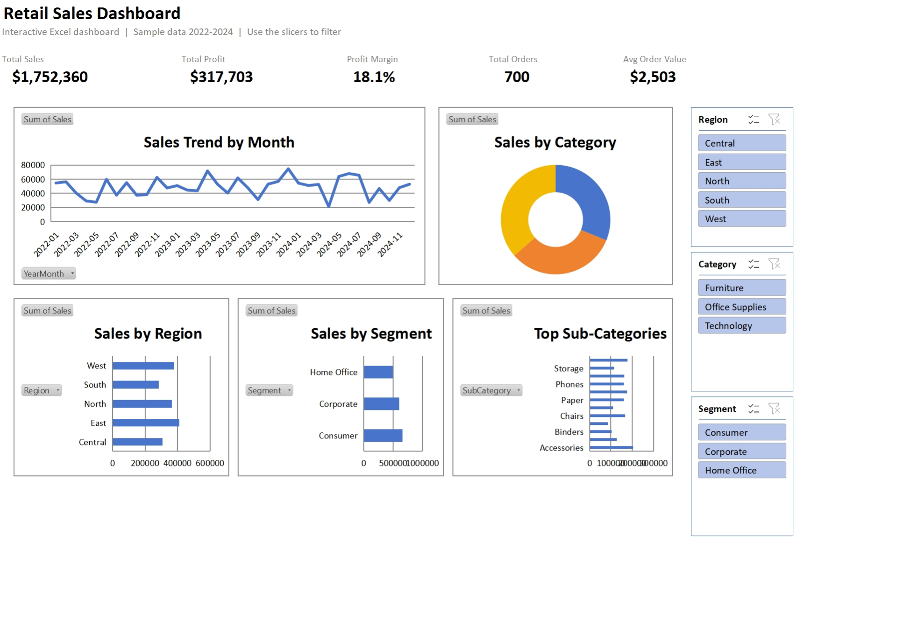

# 📗 Excel Interactive Sales Dashboard

A fully **interactive Microsoft Excel dashboard** built with **PivotTables, PivotCharts, and Slicers** — click any slicer and every KPI and chart updates live. Built from 700 retail sales orders (2022–2024).

> **Author:** Hassan Khan · Technical Project Manager & BI/Business Analyst
> **Tools:** Microsoft Excel · PivotTables · PivotCharts · Slicers · GETPIVOTDATA

---

## 🖼️ Dashboard Preview

*Download **[`Retail-Sales-Dashboard.xlsx`](Retail-Sales-Dashboard.xlsx)** and open it in Excel — click the **Region / Category / Segment** slicers to filter the whole dashboard.*

---

## 🎯 Business Questions Answered

- What are our **total sales, profit, margin, and average order value**?
- How do **sales trend month over month**?
- Which **regions, segments, categories, and sub-categories** perform best?
- How does performance change when we **filter by region, category, or segment**?

## 📌 Key Results (sample data)

| Metric | Value |
|--------|-------|
| Total Sales | **$1.75M** |
| Total Profit | **$317.7K** |
| Profit Margin | **18.1%** |
| Total Orders | **700** |
| Avg Order Value | **$2,503** |

**Insights:** **Technology** is the top category ($638K); **Consumer** is the largest segment; **East** leads regions ($413K); **Tables**, **Pens**, and **Printers** are the top sub-categories.

---

## ⚙️ How It Works (what this demonstrates)

| Component | Technique |
|-----------|-----------|
| **KPI cards** | `GETPIVOTDATA` formulas that recalculate as slicers change |
| **Sales trend** | PivotChart (line) on `YearMonth` |
| **Category split** | PivotChart (doughnut) |
| **Region / Segment / Sub-Category** | PivotCharts (bar), sub-categories sorted descending |
| **Slicers** | `Region`, `Category`, `Segment` — connected to **all** pivots so one click filters everything |
| **Data** | An Excel **Table** (`SalesData`) feeding a shared PivotCache |

All six PivotTables share a single cache and sit on a hidden **Calc** sheet; the **Dashboard** sheet holds only the visuals.

---

## 🚀 How to Use

1. Download **[`Retail-Sales-Dashboard.xlsx`](Retail-Sales-Dashboard.xlsx)**.
2. Open it in **Microsoft Excel** (Excel 2016+ or Microsoft 365).
3. On the **Dashboard** sheet, click any value in the **Region**, **Category**, or **Segment** slicer.
4. Watch every KPI and chart update instantly. Ctrl-click to multi-select; use the clear (❌) button to reset.

---

## 📁 Dataset

[`data/sample_sales_data.csv`](data/sample_sales_data.csv) — **700 orders (2022–2024)**:

| Column | Description |
|--------|-------------|
| `OrderID` | Unique order identifier |
| `OrderDate` | Date of the order |
| `Region` | North, South, East, West, Central |
| `Segment` | Consumer, Corporate, Home Office |
| `Category` / `SubCategory` | Product classification |
| `Quantity` | Units sold |
| `Sales` | Net sales amount |
| `Discount` | Discount applied |
| `Profit` | Profit for the order |
| `Year` / `YearMonth` | Date helpers for time analysis |

---

## 🛠️ Skills Demonstrated

`Excel` · `PivotTables` · `PivotCharts` · `Slicers` · `GETPIVOTDATA` · `Data Modeling` · `Dashboard Design` · `Business Analysis`

---

⭐ Part of my data analytics portfolio. This dashboard uses generated sample data. Contact: khanhassan718@yahoo.com
